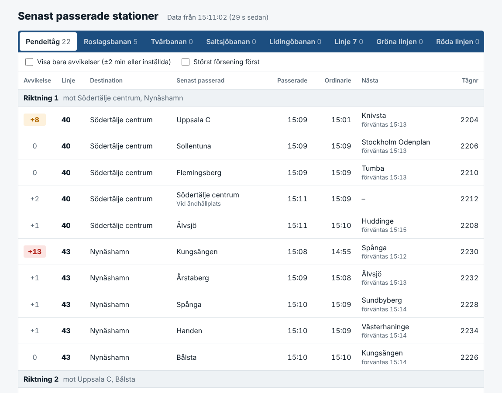

# Läget i kollektivtrafiken

En egen version av SL:s *Senast avlästa fordonspositioner* byggd på
Trafiklabs GTFS Regional (statisk + realtid) för SL. Flask-backend, en HTML-sida utan byggsteg.

## Kom igång utan nyckel (demodata)

```bash
python -m venv .venv && source .venv/bin/activate
pip install -r requirements.txt
python scripts/make_demo_data.py
DATA_DIR=demo USE_SAVED_FEEDS=true flask --app fp.server run --debug
# http://127.0.0.1:5000/#PT
```



Demodatan är påhittad. Flödet blir "inaktuellt" efter 2 minuter – kör skriptet igen.

## Med riktig data

1. Skapa ett projekt på developer.trafiklab.se och aktivera **GTFS Regional Static** och
   **GTFS Regional Realtime**. Kopiera `.env.example` till `.env` och fyll i nycklarna.
2. **Verifiera täckningen först** (laddar ner statisk data + 2 realtidsanrop):
   ```bash
   python scripts/coverage_check.py --routes   # stämmer linjenumren i fp/config.py TABS?
   python scripts/coverage_check.py            # rader per flik jämfört med tidtabellen
   python scripts/coverage_check.py --offline  # analysera igen utan nya anrop
   ```
3. Starta: `flask --app fp.server run --debug`
4. Utan lokala nycklar: kör **Actions → Täckningskontroll → Run workflow**. Resultatet syns i
   jobbets sammanfattning och de sparade `.pb`-flödena kan laddas ner som artefakt.
   Nycklarna ligger som repo-secrets `GTFS_STATIC_KEY` och `GTFS_RT_KEY`.
5. Utveckla vidare mot sparade flöden: `USE_SAVED_FEEDS=true flask --app fp.server run --debug`

## Störningar

Linje- och stationsmeddelanden hämtas från **SL Deviations**
(`https://deviations.integration.sl.se/v1/messages`, ingen nyckel, högst ett anrop per minut),
samma källa som sl.se/trafiklaget. Varje meddelande är knutet till linjer med trafikslag
(`scope.lines[].transport_mode`), så ett pendeltågsmeddelande hamnar aldrig på tunnelbanan.
Båtlinjer (SHIP) med samma nummer som gröna linjen filtreras bort på trafikslag.
GTFS-RT ServiceAlerts används för larm på enskilda turer och som reserv om SL Deviations inte svarar
(`alerts_source` i `/api/board` visar vilken källa som används).

| Visas som | Vad |
|---|---|
| Störningar | akuta trafikstörningar; räknas i flikens märke |
| Enskilda avgångar | larm på en viss tur (GTFS-RT); texten visas också på raden i tabellen |
| Planerade ändringar | trafikmeddelanden som gäller mer än 12 timmar (banarbeten, nattrafik); hopfällda |
| Hissar och entréer, Skyltar och övrigt | hopfällda; räknas inte i märket |

Kategori (`fp/alerts.py`): `categories` FACILITY eller hiss-/entréord i rubriken → hissar och entréer;
skylt-/utropsord eller `importance_level` 2 (hissar, entréer, museitrafik) → övrigt;
trafikord eller `importance_level` ≥ 7 → trafik. Akut = `urgency_level` ≥ 5 eller giltighetstid ≤ 12 h.

Reservläget (GTFS-RT): SL:s flöde saknar effekt och allvarlighetsgrad, så larm sorteras på text.
Hållplatslarm som nämner ett annat trafikslag ("Pendelns nätter" på tunnelbanans plattformar)
visas bara på det trafikslaget. Plattformsskyltens korta texter filtreras bort och dubbletter slås ihop.

Lokalt med `USE_SAVED_FEEDS=true` läses `data/deviations.json` om den finns.

## Översikt (startsida)

Fliken **Översikt** är standard och visar ett kort per trafikslag, grupperat i tunnelbana,
pendeltåg, lokalbanor och spårväg samt buss (`fp/overview.py`), och överst några meningar att
läsa upp eller kopiera. Läget för spårtrafiken:

- **Stora störningar:** minst 30 % av tågen minst 5 min sena, eller minst 4 inställda avgångar.
- **Störningar:** en akut trafikstörning i störningsflödet, någon inställd avgång, minst 20 %
  minst 3 min sena, något tåg minst 10 min sent, eller klart färre tåg med realtid än planerat.

En störning räknas som akut om den gäller i högst 12 timmar (t.ex. 09:45–12:00). Meddelanden som
gäller i dagar eller månader är planerade ändringar: de visas på kortet men påverkar inte läget
(SL publicerar om dem varje dag, så publiceringstiden säger inget). Bussens läge kommer från
bussöversikten.

## Antal i trafik

Överst i varje flik visas tåg i trafik enligt realtid (inställda räknas inte), antal enligt
tidtabellen (turer mellan första avgång och sista ankomst just nu, `planned_counts` i
`fp/board.py`), samt samma jämförelse per linje. Siffrorna färgas när klart
färre är ute än planerat (minst 2 tåg och 15 %). Linjevyn visar samma jämförelse per linje.

## Linjevy

Till vänster om tabellen (ovanför på smala skärmar) ritas vald linje som en "termometer" med
tågen mellan stationerna: ▲ uppåt, ▼ nedåt, ring i orange/rött vid försening. Positionen
räknas fram mellan senast passerad och nästa station utifrån tiderna och flyttas mjukt.
Klick på en rad markerar tåget i linjevyn och tvärtom; Esc avmarkerar. Stationsordningen kommer från linjens längsta tur
(`line_patterns` i `fp/board.py`), med nordligaste änden överst. Linjevyn kan stängas och
valet sparas i webbläsaren. På smala skärmar (under 1080 px) växlar man i stället mellan
Tabell och Linjevy med en knapp; valt tåg följer med mellan vyerna.

### Linjeträd

Har fliken flera linjer (pendeltåg, Roslagsbanan, tunnelbanans färger …) visar linjevyn först
**Alla**: en schematisk karta där linjerna förgrenar sig, med tågen som små pilar (orange/röd
vid försening). Linjeväljaren överst i fliken (Alla, 17, 18, 19 …) gäller både tabellen och
linjevyn: väljer man en linje visar tabellen bara den och linjevyn den detaljerade vyn. Layouten (`static/tree.js`) lägger längsta linjen som stam och övriga
sträckor som grenar i närmaste lediga kolumn, norrut eller söderut efter stationernas latitud.
Den prövar alla val av stam och sida och väljer varianten där flest namn får plats; namn som
inte får plats utelämnas (finns som verktygstips). Ändstationer får linjenummer.

## Bussar

Fliken **Buss** är en översikt för trafikinformatörer, inte en avgångstabell (`fp/bus.py`,
`static/bus.js`). Bussarna grupperas per område: kommun, med Stockholms stad uppdelad i
Innerstaden, Västerort och Söderort (`fp/areas.py`, gränser i `static/kommuner.geojson` från
okfse/sweden-geojson, ursprungligen Valmyndighetens data).

- **Realtid:** varje bussturs försening och var den är (senast passerade hållplats).
- **Tidtabell:** hur många turer som borde vara ute; per område och linje syns hur många som
  har realtid, så att inställda turer och saknad data märks.
- **Störningsmeddelanden:** larm på enskilda turer räknas per område och orsak
  (framkomlighetsproblem, köer, fordonsfel …). Linje- och hållplatsmeddelanden från de
  senaste 3 timmarna visas som nya, äldre som planerade ändringar.
- **Läge per område:** *Förseningar* / *Stora förseningar* när andelen bussar minst 5 min sena
  sticker ut både mot fasta gränser och mot hela länet, när många är minst 10 min sena, eller
  vid många larm eller inställda turer (`status_of`).
- **Brännpunkter:** rutor på ca 1 × 1 km med minst tre sena bussar, namngivna efter vanligaste
  hållplatsen.
- **Läget just nu:** några meningar att läsa upp eller kopiera.
- **Karta:** kommuner färgade efter läget, bussarna som prickar och brännpunkter som ringar.

Bussdatan kommer ur samma flöden som tabellen, så den kostar inga extra API-anrop.

## Snabbhet

- Tidtabellen sparas som pickle på volymen: omstart tar under en sekund i stället för 5–15 s.
- Realtid och störningar hämtas parallellt. Data upp till 5 min gammal visas direkt medan
  ny hämtas i bakgrunden.
- `/api/board` ger alla flikar i ett komprimerat svar (~11 kB), byggt en gång per ny data.
  Flikbyten sker utan nya anrop och senaste data visas direkt vid omladdning (localStorage).

## Drift på Fly.io

`fly.toml` kör en maskin (shared-cpu-1x, 256 MB) i Stockholm som alltid är igång, ca 2 USD/månad
(Fly efterskänker fakturor under 5 USD). En volym på 1 GB håller tidtabellen mellan omstarter.

Engångsuppsättning, helt i webbläsaren:

1. Fly: skapa en organisationstoken under **Tokens** och kopiera den.
2. GitHub: lägg den som repo-secret `FLY_API_TOKEN` (bredvid `GTFS_STATIC_KEY` och `GTFS_RT_KEY`).
3. GitHub: **Actions → Deploy till Fly → Run workflow**. Appen skapas, nycklarna förs över
   och sidan hamnar på `https://tabellen.fly.dev`. Är namnet upptaget, byt `app` i `fly.toml`.

Därefter deployas varje push till `main` automatiskt (efter att testerna gått igenom).
Sidan är publik, men realtidsanrop cachas (TripUpdates 30 s, ServiceAlerts 120 s) och stoppas vid `RT_MONTHLY_BUDGET`.

## Struktur

```
fp/config.py        nycklar, gränser, flikar -> linjenummer
fp/static_gtfs.py   nedladdning (max 1/dygn) och filtrerad inläsning av sl.zip
fp/realtime.py      GTFS-RT på begäran, cache och månadsbudget (data/usage.json)
fp/board.py         slår ihop statisk + realtid till tabellrader
fp/server.py        /api/tabs, /api/board?tab=PT, /api/health
static/index.html   gränssnittet
scripts/            coverage_check.py, make_demo_data.py
tests/              syntetiska tester: python -m pytest
```

## Fält jämfört med kitt

| kitt | Här | Källa |
|---|---|---|
| Avvikelse | `delay_min`, **+ = sen** (kitt: − = sen) | TripUpdates, försening propageras nedströms |
| Destination | `destination` | `trip_headsign` |
| Avläsningsplats | `observed_stop` | senast passerade hållplats i TripUpdates, reserv: VehiclePositions |
| Avläsningstid | `passed_at` = när tåget passerade | faktisk tid vid avläsningsplatsen |
| Ordinarie avgångstid | `scheduled_at` vid **samma** hållplats | `stop_times.txt` |
| Tågnummer | `train_number` | `trip_short_name`, fallback linjenummer |
| Riktning 1/2 | `direction_id` + vanligaste destinationerna | `trips.txt` |
| – | `next_stop`, `next_expected_at`, `status` (inställd/ändhållplats), `line` | nytt |

`observed_source` visar hur avläsningsplatsen togs fram: `tripupdate`, `tripupdate-inferred`
(flödet saknade passerade hållplatser, markeras ≈), `vehicleposition` (◦) eller `schedule`.

## Kvoter

| Nyckel | Bronze | Konsekvens |
|---|---|---|
| Static | 50/månad | laddas ner max en gång per dygn, efter 07:00 |
| Realtime | 30 000/månad | hämtas bara när någon tittar, cache 30 s. Kontinuerlig drift = ~86 000/mån → **Silver** |

`RT_MONTHLY_BUDGET` stoppar hämtning innan nyckeln spärras. `USE_VEHICLE_POSITIONS=true` dubblar anropen.

## Verifierat mot riktig data (19 nov 2026)

- [x] Alla nio flikar finns i TripUpdates, med ungefär lika många rader som tidtabellen förväntar.
- [x] TripUpdates behåller passerade hållplatser, så avläsningsplatsen kommer direkt ur flödet.
- [x] Spårlinjerna har route_type 100 (pendeltåg), 401 (tunnelbana) och 900 (spårväg/lokalbanor).
      SL:s båtlinjer (route_type 1000) har krockande nummer (10, 13, 21 …) och filtreras bort.
- [x] `trip_short_name` är tomt för SL. Tågnumret tas från `samtrafiken_internal_trip_number`.
- [ ] Jämför avvikelse mot kitt vid samma tidpunkt för några tågnummer.
- [x] Gruppering sker på `direction_id` (0 → Riktning 1, 1 → Riktning 2) utan tolkning av norr/söder.
      Matchar inte nödvändigtvis kitts numrering, och det är medvetet.
- [ ] Nockebybanan (linje 12) finns i datan men inte i kitt. Lägg till som egen flik?

## Idéer från intervjuerna med trafikinformatörerna

Filtrering på avvikelser och sortering på försening finns redan. Nästa kandidater:
ServiceAlerts per linje, trend (ökar förseningen?), markering av tåg som slutat rapportera,
samt Nockebybanan (linje 12) som saknas i kitt.

## Kurvan "Senaste timmen"

Översiktskorten och bussområdena visar andelen sena (spår: minst 3 min, buss: minst 5 min)
per 5 minuter senaste timmen. Ett värde sparas per nytt realtidsflöde, alltså bara när någon
har sidan öppen, så det kostar inga extra anrop mot Trafiklab. Historiken (senaste 2 timmarna)
sparas i `DATA_DIR/history.json` på Fly-volymen och överlever omstarter (`fp/history.py`).
Luckor betyder att ingen hade sidan öppen; ensamma värden ritas som prickar.

